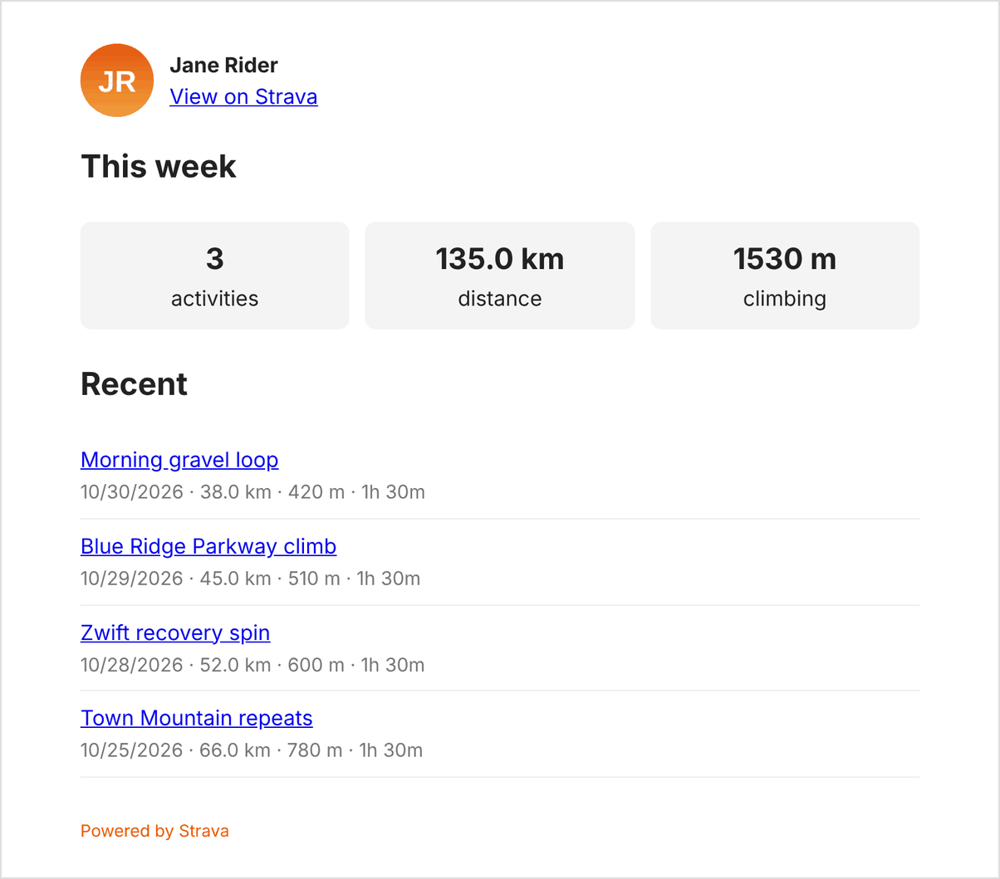
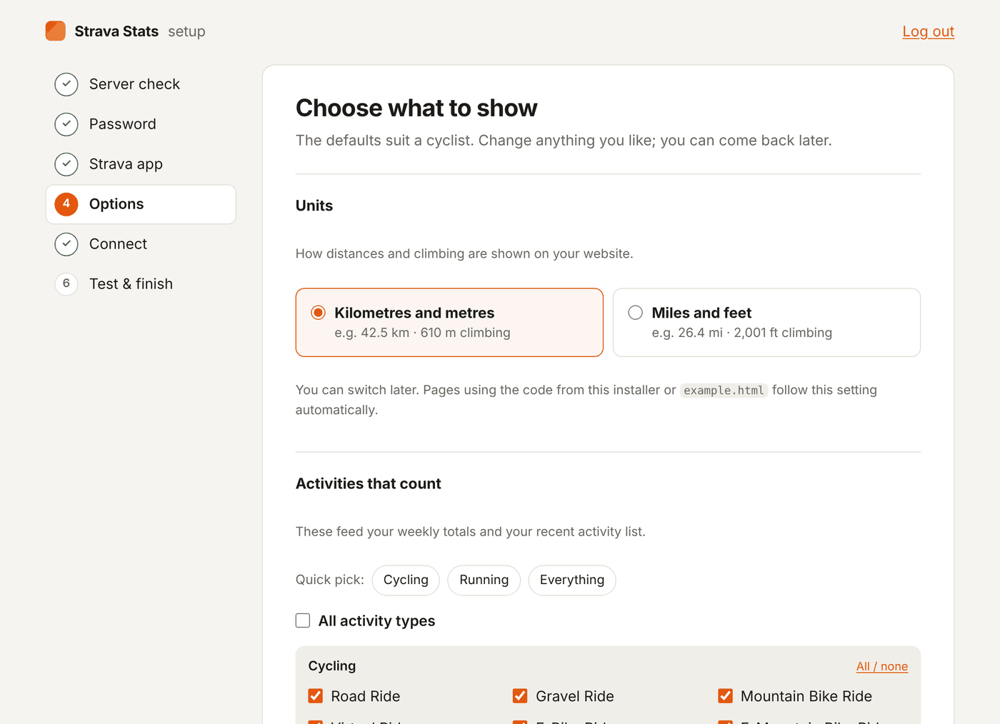
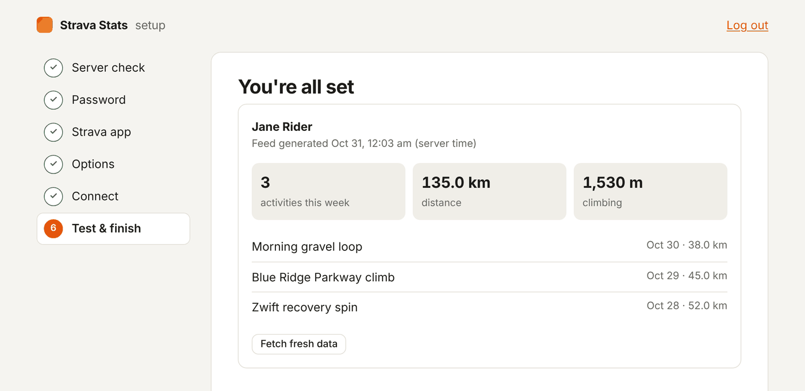

# Strava Stats

**Show your Strava activity on your own website, updated automatically.**

Put your weekly distance, your latest rides or runs, and your year-to-date totals on your site, and they stay up to date by themselves. You set it up once in your web browser, with no coding and no file editing.

What your visitors can see (you choose which parts):

- Your name, photo and a link to your Strava profile
- This week's totals: number of activities, distance and climbing
- Your most recent activities
- Your totals for the last 4 weeks, this year and all time

<p align="center">
  
  <br><em>The ready-made card included in the download, shown here with sample data.</em>
</p>

Your private details stay private. Anything you don't choose to show never leaves your server, and you can't post, edit or delete anything on Strava through this tool. It can only read.

> Strava Stats is a free, independent project. It isn't made or endorsed by Strava.

---

## Contents

- [Before you start](#before-you-start)
- [Step by step](#step-by-step)
- [Show your stats on your website](#show-your-stats-on-your-website)
- [Changing your settings later](#changing-your-settings-later)
- [If something isn't working](#if-something-isnt-working)
- [Common questions](#common-questions)
- [Strava's rules](#stravas-rules)

---

## Before you start

You'll need:

- **A website with PHP.** Most ordinary web hosting includes it (for example Bluehost, SiteGround, Hostinger, DreamHost or cPanel hosting). Website builders like Squarespace, Wix and Webflow can't run PHP, but you can still use them to *display* your stats if Strava Stats runs on another host (see [Common questions](#common-questions)).
- **A way to upload files to your site.** Usually that's your host's **File Manager** in its control panel, or an FTP program such as FileZilla or Cyberduck.
- **A Strava account.**
- **About 10 minutes.**

---

## Step by step

### 1. Download Strava Stats

On the project's [GitHub page](https://github.com/JShipps/strava-stats), click the green **Code** button, then **Download ZIP**. Unzip it on your computer. You'll get a folder called `strava-stats` (it may be called `strava-stats-main`; rename it to `strava-stats`).

### 2. Upload the folder to your website

Upload the whole `strava-stats` folder to your website's main folder. That folder is often called `public_html`, `www` or `htdocs`.

When you're done, this address should open something (not a "page not found" error):

```
https://your-website.com/strava-stats/setup.php
```

Replace `your-website.com` with your own domain.

### 3. Open the installer straight away

Go to `https://your-website.com/strava-stats/setup.php` in your browser. The installer guides you through six short screens.

> **Do this right after uploading.** The first person to open the installer gets to choose its password, so you want that to be you.

1. **Server check.** Makes sure your hosting has everything needed. If something is marked with a ✕, the screen tells you how to fix it. If you see "Can't save config.php" or "Can't save tokens and cache," see [If something isn't working](#if-something-isnt-working).

2. **Password.** Choose a password for the installer. You'll need it whenever you come back to change settings. (It isn't your Strava password, and you don't need to give the installer that.)

3. **Strava app.** Strava asks everyone who connects a website to create a free "API application." It's just a short form. The installer tells you exactly what to type:
   - Open [strava.com/settings/api](https://www.strava.com/settings/api) and log in.
   - Fill in the form. For **Authorization Callback Domain**, copy the value the installer shows you. It's your website's domain, like `your-website.com`, and it **must be exactly right**.
   - Click **Create**. Strava may ask for an icon first; any picture will do.
   - Copy the **Client ID** and **Client Secret** (click "Show" to reveal it) back into the installer.

4. **Options.** First, pick your **units**: kilometres and metres, or miles and feet. Then choose what counts and what's shown. Not sure? Click **Cycling**, **Running** or **Everything** and leave the rest as it is. You can change all of this later.

5. **Connect.** Click **Connect with Strava**. Strava asks whether you want to allow access. Click **Authorize** and you'll come straight back to the installer.

6. **Test & finish.** You'll see a preview of your stats, a link to your feed, and a ready-made block of code to put on your website. The installer also checks that your private connection details can't be downloaded by anyone else.

<p align="center">
  
  <br><em>The Options screen. The steps down the left show how far along you are.</em>
</p>

<p align="center">
  
  <br><em>The last screen previews your stats so you know it's working before you add it to your site.</em>
</p>

### 4. Lock the installer

When everything looks right, click **Lock installer** on the last screen. That switches the installer off so nobody else can change your settings. You can turn it back on later (see [Changing your settings later](#changing-your-settings-later)).

---

## Show your stats on your website

The last screen of the installer gives you a block of code with your website's address already filled in. Copy it and paste it into your page wherever you want your stats to appear:

- **WordPress:** edit the page, add a **Custom HTML** block, and paste the code into it.
- **Squarespace:** add a **Code** block.
- **Wix:** use **Embed Code → Embed HTML**.
- **Your own HTML page:** paste it where you want the stats to show.

It looks like this (with your address instead of `your-website.com`):

```html
<div id="strava"></div>
<script>
fetch('https://your-website.com/strava-stats/strava.php')
  .then(r => r.json())
  .then(data => {
    const miles = data.display_units === 'imperial';
    const d = miles ? (data.week.distance / 1609.344).toFixed(1) + ' mi'
                    : (data.week.distance / 1000).toFixed(1) + ' km';
    document.getElementById('strava').textContent =
      `${data.week.count} activities, ${d} this week`;
  });
</script>
```

That shows a single line, like *"3 activities, 83.9 mi this week"*, in the units you chose in the installer.

**Want something nicer?** The download includes `example.html`, a ready-made card with your photo, this week's totals in boxes, and your recent activities. Open `https://your-website.com/strava-stats/example.html` to see it working. To use it on your own page, copy its contents, then near the top change `const ENDPOINT = 'strava.php';` to your full feed address, e.g. `const ENDPOINT = 'https://your-website.com/strava-stats/strava.php';`. It uses the units you chose in the installer.

**Using Squarespace, Wix or a site on a different domain?** If your stats are displayed on a different domain from the one Strava Stats is installed on, open the installer, go to **Options → Other websites**, and add your site's address (for example `https://my-portfolio.com`). Otherwise the browser will refuse to load the stats.

Your stats refresh by themselves. By default Strava Stats checks Strava for new activities every 5 minutes.

---

## Changing your settings later

1. If you locked the installer, unlock it first: open the file `strava-stats/config.php` in your host's File Manager, find the line `'setup_locked' => true,`, change `true` to `false`, and save.
2. Go to `https://your-website.com/strava-stats/setup.php` and log in with your installer password.
3. Change what you want, then lock the installer again.

**Forgot your installer password?** Open `config.php`, delete the whole line that starts with `'setup_password_hash'`, and save. When you open the installer again, it asks for your Strava **Client Secret** (from [strava.com/settings/api](https://www.strava.com/settings/api)) to prove the site is yours, then lets you choose a new password.

**Changed your mind about private activities or FTP and weight?** After changing those options, the installer asks you to click **Reconnect** so Strava can ask for your permission again.

---

## If something isn't working

**The installer says "Can't save config.php" or "Can't save tokens and cache."**
Your host isn't letting the installer save files. In your File Manager or FTP program, find the `strava-stats` folder and the `data` folder inside it, open their **Permissions** (sometimes called "Change permissions" or "CHMOD"), and set them to **775**. Then click **Check again**. If that doesn't help, ask your host to "make the strava-stats folder writable by PHP."

**After clicking "Connect with Strava," Strava shows "redirect_uri invalid."**
The **Authorization Callback Domain** in your Strava app doesn't match your website. Go to [strava.com/settings/api](https://www.strava.com/settings/api), click **Edit**, and enter exactly the domain the installer shows you, such as `your-website.com`, without `https://` or a slash at the end.

**Nothing shows up on my page.**
- Open `https://your-website.com/strava-stats/strava.php` in your browser. If you see a page of text with your name and numbers, Strava Stats is working, and the problem is in the code on your page: check you copied the whole block.
- If that address shows an error message, open the installer and go to **Test & finish**. It explains what's wrong.
- If your page is on a different domain, see the note about **Other websites** above.

**The page says "Strava data is unavailable right now."**
Open the installer and go to **Test & finish** to see the full reason. Most often your Strava connection was removed (for example in Strava's settings), and you just need to click **Reconnect**.

**My totals look too low.**
- Strava's yearly and all-time totals only include activities that are visible to **Everyone**. Check the privacy setting on your activities in Strava.
- If you log a lot of activities in a week, raise **How many to fetch** in the installer's Options.

**The installer's security check says "Your tokens are public!"**
Your web server is letting people download the file that holds your Strava connection. Copy the rule the installer shows and send it to your host's support team, asking them to add it to your site's server configuration. Or, in the installer, go to **Options → Advanced** and move the token file to a folder outside `public_html`.

**I want to switch between miles and kilometres.**
Open the installer, go to **Options**, and change **Units**. Pages using the installer's code or `example.html` switch over by themselves within a couple of minutes. There's nothing to edit on your page.

**I changed a setting and my page didn't change.**
Your stats are saved for a few minutes so Strava isn't asked too often. Wait 5 minutes, or click **Fetch fresh data** on the installer's last screen.

**The installer says "The installer is locked."**
That's expected after you lock it. See [Changing your settings later](#changing-your-settings-later).

---

## Common questions

**Is it safe?**
Your Strava secret and connection details stay on your server and are never sent to visitors. The installer is password-protected, and you lock it when you're done. Strava Stats can only *read* your Strava data, never change it. You can cut off its access at any time in Strava under **Settings → My Apps → Revoke Access**.

**Will it show my private activities?**
Only if you tick **Include "Only You" activities** in the installer's Privacy options. They then count towards your weekly totals and can appear in your recent list. Leave it unticked to keep them out.

**My website is on Squarespace, Wix or Webflow. Can I use this?**
Those builders can't run Strava Stats themselves, but they can *display* it. Install Strava Stats on any cheap PHP hosting (or a subdomain of a host you already have), add your builder site under **Options → Other websites**, and paste the code into a Code or Embed block.

**Can it show more than one person?**
Each copy shows one Strava account. For two people, upload a second copy in a different folder (for example `strava-stats-sam`) and run its installer. Note that Strava only lets a new app connect its owner's account until you ask Strava to approve it for more people.

**How do I update to a new version?**
Upload the new files over the old ones, but **keep your `config.php` file and your `data` folder**. Your settings and connection carry over.

**Do I have to use the installer?**
No. If you're comfortable with a terminal and editing PHP files, the [advanced guide](docs/ADVANCED.md) explains how to set everything up by hand.

**I'm a developer. Where are the details?**
The [advanced guide](docs/ADVANCED.md) covers every setting, the full JSON format, environment variables, server rules for nginx and Caddy, caching and rate limits, cron, and using the library directly from PHP.

---

## Strava's rules

Strava lets you use your data like this as long as you follow its [API Agreement](https://www.strava.com/legal/api) and [brand guidelines](https://developers.strava.com/guidelines/). In short:

- Show a **"Powered by Strava"** logo near your stats. You can download it from the brand guidelines page.
- Link back to Strava. Your stats include links to your profile and each activity for this.
- Don't suggest that Strava endorses your website.

---

## License

MIT License

Copyright (c) 2026 Jason Shipps

Permission is hereby granted, free of charge, to any person obtaining a copy
of this software and associated documentation files (the "Software"), to deal
in the Software without restriction, including without limitation the rights
to use, copy, modify, merge, publish, distribute, sublicense, and/or sell
copies of the Software, and to permit persons to whom the Software is
furnished to do so, subject to the following conditions:

The above copyright notice and this permission notice shall be included in all
copies or substantial portions of the Software.

THE SOFTWARE IS PROVIDED "AS IS", WITHOUT WARRANTY OF ANY KIND, EXPRESS OR
IMPLIED, INCLUDING BUT NOT LIMITED TO THE WARRANTIES OF MERCHANTABILITY,
FITNESS FOR A PARTICULAR PURPOSE AND NONINFRINGEMENT. IN NO EVENT SHALL THE
AUTHORS OR COPYRIGHT HOLDERS BE LIABLE FOR ANY CLAIM, DAMAGES OR OTHER
LIABILITY, WHETHER IN AN ACTION OF CONTRACT, TORT OR OTHERWISE, ARISING FROM,
OUT OF OR IN CONNECTION WITH THE SOFTWARE OR THE USE OR OTHER DEALINGS IN THE
SOFTWARE.
